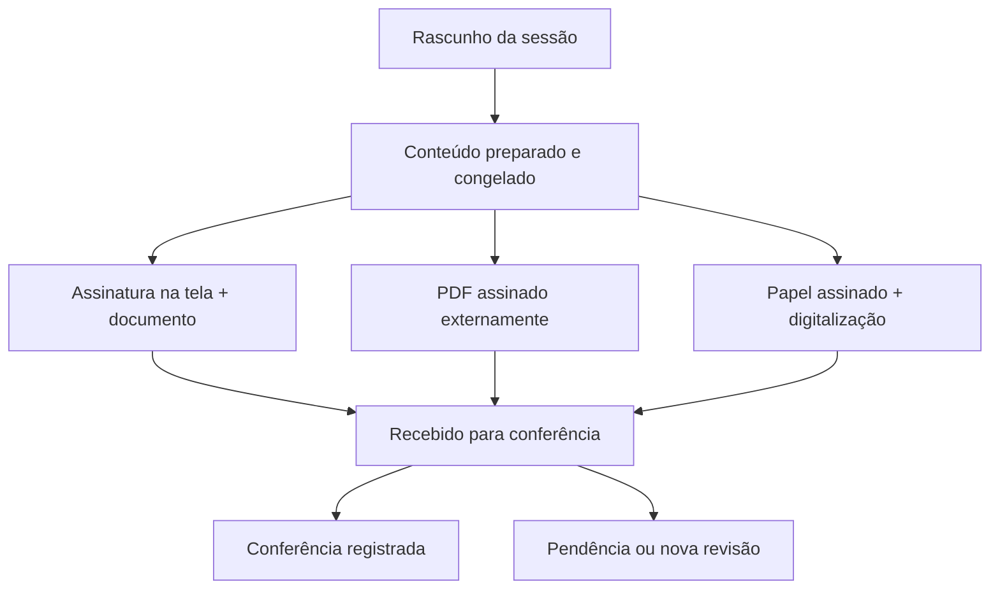

# Anamnese, assinaturas e conclusão de sessão — especificação de implementação

Versão 1.0 · 21/10/2026 · CRM Tatuei

**Estado:** especificação pronta para orientar o desenvolvimento. Não representa funcionalidade instalada, migração executada ou parecer jurídico. A redação final dos termos requer revisão jurídica considerando a operação e as normas locais.

## 1. Resultado esperado

Cada sessão terá sua anamnese revisada e assinada e poderá ter um documento próprio de conclusão. O cliente poderá assinar na tela, devolver o PDF original assinado externamente pelo Gov.br ou assinar o documento impresso, posteriormente digitalizado pelo profissional. O CRM preservará os registros anteriores, as evidências e a cópia disponibilizada ao cliente.

Geolocalização está fora desta versão: não criar campos de latitude/longitude, pedir localização, inferir localização pelo IP ou condicionar o preenchimento a essa permissão.

São documentos distintos:

| Documento | Momento e finalidade |
|---|---|
| Anamnese e consentimento para a sessão | Antes do procedimento; revisar informações, esclarecer riscos e registrar autorização específica. |
| Termo de Conclusão de Sessão, Ciência e Manifestação do Cliente | Depois da sessão; registrar atendimento realizado, orientações, intercorrências e manifestação do cliente. |
| Complemento/retificação | Nova versão ou documento relacionado, quando houver correção posterior; nunca substitui silenciosamente o conteúdo assinado. |

O documento posterior não funciona como autorização retroativa. Satisfação imediata não equivale a cicatrização concluída. O cliente pode registrar ressalvas, discordância ou optar por não avaliar a satisfação. O silêncio não é aceite.

## 2. Base existente e alterações necessárias

Base de código inspecionada: árvore `b6835ed05f9229e91de7e43283fcb05a1a96c599`, correspondente ao commit remoto `896630f691b32167b3a8deb9fbca6f483b44a0dc` na branch `fix/artist-contact-complete-20261011`. Isso identifica o código analisado; não atesta qual versão está em produção.

| Ponto existente | Integração planejada / lacuna encontrada |
|---|---|
| `client/src/pages/PublicAnamnese.tsx` e `shared/anamnese.schema.json` | Preservar perguntas e validações; acrescentar etapa final de assinatura conforme versão exigida pela sessão. |
| `server/routers.ts`, router `anamnese`, e `server/db.ts`, `savePublicAnamnese` | Atualmente atualizam respostas da mesma solicitação. Para registros assinados, substituir a edição destrutiva por nova revisão. Validar todas as rotas alternativas. |
| `server/anamneseReview.ts` | Aproveitar apenas respostas compatíveis; remover do pré-preenchimento assinatura, aceite, datas e evidências da sessão anterior. |
| `server/attendance/service.ts`, `client/src/components/AttendancePanel.tsx` | A conclusão do atendimento já é registrada. Acrescentar ação explícita para preparar/enviar o termo; não alterar a data do agendamento ou os marcos do pós-venda. |
| `server/routers/procedures.ts`, `server/routers/podSaas.ts` e `server/sessionMaterials.ts` | Usar consumos efetivos; materiais apenas planejados não provam uso. A geração documental nunca movimenta estoque. |
| `procedure_inventory_consumptions` e `inventory_batches` | Já possuem vínculo de consumo/lote e cópias de dados técnicos. Faltam campos estruturados e confiáveis para fabricante e regularização Anvisa. |
| `server/minorConsent/*` e `client/src/pages/PublicMinorConsent.tsx` | Aproveitar padrões de arquivos privados, PDF externo e conferência. Preservar o fluxo de menores, sem substituí-lo pelo termo adulto. |
| `server/messaging/provider.ts` e `server/messaging/service.ts` | A interface comum inspecionada envia texto. Anexo PDF exige extensão explícita; link privado de download é alternativa funcional inicial. |
| `server/storage.ts` | Reaproveitar o armazenamento durável; não expor as URLs genéricas estáveis para os novos documentos privados. |
| `client/src/pages/ClientProfile.tsx`, `AnamneseView.tsx` e `AnamnesePdf.tsx` | Acrescentar histórico de documentos e cópias por sessão, com método, situação e trilha de conferência. |

## 3. Regras que não podem ser quebradas

- Cada nova sessão tem solicitação e aceite próprios. Uma anamnese antiga serve de base para revisão, não de assinatura ou consentimento da nova sessão.
- A versão do formulário e do termo fica registrada. Conteúdo preparado/assinado não muda quando o modelo, o cadastro ou o estoque muda.
- Fichas legadas permanecem consultáveis e identificadas como legadas; não gerar assinatura, autorização ou conclusão retroativa.
- Toda nova sessão após ativação exige a política vigente, mesmo que o cliente tenha link/ficha antiga. Criar uma solicitação adequada à nova sessão, preservando a anterior.
- Não migrar o agendamento original ao criar outras sessões. Não reiniciar prazos de pós-venda pela assinatura, conferência ou anexação de materiais.
- Concluir a sessão, receber o termo, conferir o termo e entregar sua cópia são situações independentes.
- A opção de incluir insumos começa desativada em cada documento e precisa de ação explícita do artista responsável; delegado só com permissão documentada.
- A escolha de divulgar imagens é separada do consentimento para procedimento e do registro técnico necessário ao atendimento. Preservar os aceites antigos; a nova versão não reutiliza a cláusula antiga como autorização nova.
- Receber WhatsApp permanece uma escolha própria. A nova assinatura não concede consentimento de marketing nem reverte opt-out.

## 4. Fluxos de ponta a ponta

### 4.1 Nova sessão e anamnese

1. Ao preparar uma nova sessão, resolver estúdio, cliente, artista e agendamento no servidor. Criar/reutilizar, de modo idempotente, a solicitação de revisão daquela sessão e política.
2. Carregar respostas anteriores compatíveis como sugestões. O cliente revisa dados de saúde atuais e preenche novos campos obrigatórios. Aceite do termo e assinatura começam vazios.
3. Mostrar o documento completo e a identificação da sessão antes de assinar. O botão final indica as pendências reais.
4. Selecionar um dos três métodos abaixo. Gerar evidências vinculadas à revisão exata.
5. Receber e validar os requisitos mínimos no servidor. Gravar respostas, recibo, eventos e tarefas pendentes na mesma transação de banco.
6. Mostrar separadamente “Ficha recebida” e “Conferência documental pendente/concluída”. Upload não equivale a autenticação da identidade ou validação criptográfica.
7. Na ficha do cliente, exibir a nova sessão e manter as anteriores disponíveis. A cópia poderá ser baixada pelo cliente e sua entrega será processada em fila.

Uma anamnese geral sem agendamento pode continuar existindo. Ela não satisfaz automaticamente a exigência de aceite específico de uma sessão nova.

### 4.2 Assinatura orgânica

- Abrir modal amplo com área horizontal. Tentar orientação landscape/tela cheia quando suportado. Em navegadores incompatíveis, orientar a rotação e manter área horizontal utilizável, sem travar o formulário.
- Usar Pointer Events para mouse, dedo e caneta; impedir rolagem apenas durante o desenho no canvas.
- Renderizar quatro linhas paralelas com opacidade de 30% em camada visual separada. Não exportar as linhas na imagem da assinatura.
- Manter traços separados: **Refazer** desfaz o último traço; **Apagar** limpa todos; **Aceitar** confirma um desenho com conteúdo.
- Preservar o desenho ao redimensionar/girar o dispositivo. Escalar a resolução considerando densidade de pixels.
- Após aceitar, abrir a etapa de documento com ações “Fotografar documento” e “Enviar foto”. Abertura da câmera depende do gesto/permissão do dispositivo.
- Exigir foto legível de documento e os lados necessários à identificação. Não considerar a simples existência da foto como documento autêntico; registrar conferência do profissional.
- Qualquer alteração nas respostas, termo, documento ou dados relevantes após preparar o contexto invalida o aceite pendente e exige nova confirmação/assinatura.
- Não reutilizar a assinatura da sessão anterior. A nova coleta usa um contexto/nonce específico. Detecção de imagem vazia não comprova identidade ou validade jurídica da assinatura.

### 4.3 PDF assinado externamente pelo Gov.br

1. Congelar o conteúdo e gerar o PDF para assinatura com identificador da revisão.
2. Disponibilizar download e orientar o cliente a assinar no portal oficial e devolver o PDF original.
3. Preservar o PDF devolvido byte a byte. Não reimprimir, comprimir, mesclar, inserir carimbo ou recriar o arquivo assinado.
4. Conferir o conteúdo correspondente à revisão, a identidade do signatário e o resultado de validação. Arquivos PDF não são aceitos como assinados apenas pela extensão, por uma imagem visual de assinatura ou pelo retorno de uma página de login.
5. Até a conferência, mostrar “PDF recebido — aguardando conferência”. Registrar profissional, data, resultado, relatório e ressalvas.

A versão inicial usa o fluxo externo. Não anunciar integração direta com a API Gov.br: a documentação de produção exige credenciamento público e domínio oficial. Conta do cliente prata/ouro não habilita, por si, a API do CRM privado. O código pode reservar um adaptador futuro, desabilitado e sem botão que prometa integração indisponível.

Hash do PDF preparado e hash do PDF assinado são diferentes. A correspondência é verificada pelo conteúdo/revisão e pela assinatura, não pela igualdade desses dois hashes. Um PDF de outro atendimento, ainda que validamente assinado, não é o termo desta sessão.

### 4.4 Impressão, assinatura manuscrita e digitalização

1. O artista gera PDF com identificação das partes e sessão, número da revisão, páginas numeradas e campos para assinatura e data.
2. O cliente lê e registra sua manifestação. Assinaturas necessárias são definidas pelo modelo: cliente e, no termo de conclusão, profissional/responsável pelo registro. Menores seguem o protocolo próprio de representação/assentimento.
3. O texto prevê o acordo sobre digitalização, guarda e entrega da cópia, sujeito à revisão jurídica. Nunca preencher declaração de satisfação pelo cliente.
4. O profissional autenticado fotografa/escaneia todas as páginas e ordena os anexos. Há prévia para conferir cortes, reflexos, legibilidade e assinaturas.
5. O servidor guarda as imagens originais e produz uma cópia PDF digitalizada para consulta/entrega. O PDF em branco é mantido como modelo emitido, não apresentado como documento assinado.
6. O profissional registra “Conferi o documento digitalizado com o original” e a localização administrativa do papel, quando aplicável. Conferência humana não deve ser rotulada como autenticação cartorial.
7. Guardar separadamente data declarada da assinatura em papel, horário do recebimento pelo servidor e responsável pela digitalização. Horários declarados não substituem os horários auditados do servidor.
8. Manter orientação de conservação do original físico e plano de retenção revisado juridicamente. Não habilitar descarte automático baseado apenas na existência de uma fotografia.

Contagem de páginas e hashes auxiliam a conferência; não provam, sozinhos, que o papel foi realmente assinado pelo cliente. OCR pode auxiliar no futuro, mas não é requisito nem substitui conferência na versão inicial.

### 4.5 Conclusão e manifestação do cliente

1. O atendimento já está concluído pelo fluxo atual. Artista autenticado acessa **Enviar Conclusão de Sessão** na agenda/POD ou ficha do cliente.
2. O servidor valida autoria/permissões e captura serviço realizado, datas, partes, intercorrências e orientações. O termo não é disparado automaticamente só porque a sessão terminou.
3. O artista revisa a prévia e escolhe incluir ou não a relação dos insumos. Caso faltem dados, pode completar o registro técnico e voltar depois; isso não altera a conclusão da sessão.
4. O artista confirma preparar/enviar. O cliente recebe link limitado ao documento ou utiliza a modalidade impressa.
5. O cliente confirma ciência do atendimento descrito e recebimento das orientações. A manifestação é uma escolha explícita: `satisfeito`, `com_ressalvas`, `insatisfeito` ou `prefere_nao_avaliar`; sem opção pré-selecionada. Observações ficam preservadas.
6. O cliente assina pelo método escolhido. Se recusar assinatura, o artista pode registrar a ocorrência como declaração própria, jamais como assinatura ou aceite do cliente.
7. O CRM preserva o termo, sua relação com a anamnese da sessão e a cópia para o cliente. Recebimento de discordância não impede salvar, entregar a cópia ou realizar acompanhamento.

O vínculo com a anamnese é escolhido/conferido e congelado na preparação: não procurar automaticamente “a última ficha do cliente” a cada consulta. Em atendimento legado sem ficha prévia identificável, registrar essa ausência como pendência; uma conclusão posterior não pode ser apresentada como comprovação de consentimento prévio que não existe.

Links operacionais de atendimento já existentes não ganham acesso público ao estoque ou à anamnese completa. A ação documental administrativa exige sessão autenticada e permissões adequadas.

## 5. Estados e transições

Manter três eixos. Não usar um único campo “assinado” para todos os efeitos.

| Eixo | Estados |
|---|---|
| Conteúdo documental | `draft`, `prepared`, `received`, `cancelled`, `expired`, `superseded` |
| Conferência | `not_submitted`, `pending`, `checked`, `needs_correction` |
| Entrega | `not_requested`, `pending`, `queued`, `provider_accepted`, `delivered`, `read`, `failed`, `unavailable` |



- Abrir link é leitura; não registra aceite, satisfação ou assinatura.
- O convite pode partir de um rascunho pronto para o cliente revisar. As respostas, observações e manifestação que serão assinadas precisam estar completas antes de `prepare` congelar o conteúdo final e antes do desenho/assinatura externa. Preencher os campos previstos do rascunho não é alteração retroativa; mudar conteúdo já preparado exige nova revisão. Para papel, os campos manuscritos são preservados na digitalização e conferidos, sem serem apresentados como respostas eletrônicas prestadas diretamente pelo cliente.
- `prepared` congela conteúdo e manifesto dos anexos. Se precisar mudar, criar nova revisão e invalidar somente a capacidade de assinar a revisão antiga.
- `received` é terminal para o conteúdo daquela revisão. Conferências, entregas e retificações são eventos relacionados, sem reescrever o arquivo recebido.
- A cópia recebida pode ser disponibilizada antes da conferência, com a situação no portal ou em recibo separado. Não alterar o PDF criptograficamente assinado para acrescentar essa situação.
- `checked` significa conferência registrada pelo profissional; não significa decisão judicial de validade ou certificação por autoridade pública.
- Uma revisão substituída continua no histórico. Prazo vencido de link não apaga o documento nem impede novo acesso autorizado à cópia.
- Evento de correção de presença/falta após emissão do termo cria alerta e trilha de divergência, sem apagar o termo ou reescrever sua sessão.

## 6. Modelo de dados proposto

Usar MySQL/InnoDB e migração aditiva. IDs legados mantêm seus tipos; as novas FKs só são criadas após verificar tipos e índices reais. Colunas temporais técnicas usam UTC com milissegundos; apresentação usa fuso configurado do estúdio e DD/MM/AAAA. Não criar tabelas/colunas de geolocalização.

### 6.1 Novas tabelas

| Tabela | Campos e função |
|---|---|
| `consent_template_versions` | `id INT PK`, `studio_id INT`, `artist_id INT NULL`, `kind VARCHAR(32)`, `version VARCHAR(40)`, `schema_json JSON`, `terms_json JSON`, `signature_policy_json JSON`, `legal_review_status VARCHAR(24)`, `created_by INT`, `created_at DATETIME(3)`, `activated_at DATETIME(3) NULL`. Linhas ativadas são imutáveis. |
| `session_consent_cases` | `id INT PK`, `document_uuid CHAR(36) UNIQUE`, `studio_id`, `client_id`, `artist_id`, `appointment_id INT NULL`, `procedure_id INT NULL`, `kind`, `anamnese_request_id INT NULL`, `anamnese_submission_id INT NULL`, `legacy_anamnesis_id INT NULL`, `current_revision_id INT NULL`, `lock_version INT`, `created_by`, `created_at`. Agrega o histórico do documento. |
| `session_consent_revisions` | `id INT PK`, `studio_id`, `case_id`, `revision_no INT`, `template_version_id`, `source_submission_id INT NULL`, `supersedes_revision_id INT NULL`, `content_json JSON`, `parties_json JSON`, `manifest_json JSON`, `content_sha256 CHAR(64)`, `signature_method VARCHAR(24)`, `include_materials TINYINT DEFAULT 0`, `content_state VARCHAR(24)`, `review_state VARCHAR(24)`, `prepared_at`, `received_at`, `created_at DATETIME(3)`, `prepared_by INT NULL`, `request_nonce_hash CHAR(64) NULL`. Conteúdo clínico, termos, partes e materiais ficam congelados por revisão. |
| `consent_signature_receipts` | `id INT PK`, `studio_id`, `revision_id`, `signer_role VARCHAR(24)`, `method VARCHAR(24)`, `source VARCHAR(24)`, `client_declarations_json JSON`, `satisfaction VARCHAR(32) NULL`, `client_observations TEXT NULL`, `declared_signed_at DATETIME(3) NULL`, `provider_signed_at DATETIME(3) NULL`, `received_at DATETIME(3)`, `capture_user_id INT NULL`, `idempotency_key VARCHAR(160) UNIQUE`. Separar quem assinou de quem anexou. |
| `consent_file_assets` | `id CHAR(36) PK`, `studio_id`, `revision_id`, `purpose VARCHAR(32)`, `page_index INT NULL`, `storage_key VARCHAR(500) UNIQUE`, `mime_type VARCHAR(100)`, `size_bytes INT`, `sha256 CHAR(64)`, `origin VARCHAR(24)`, `uploaded_by INT NULL`, `created_at DATETIME(3)`. Não guardar URL pública estável. |
| `consent_material_snapshots` | `id INT PK`, `studio_id`, `revision_id`, `consumption_id INT`, `batch_id INT NULL`, `manufacturer_name VARCHAR(255)`, `lot VARCHAR(120)`, `expires_on DATE NULL`, `anvisa_number VARCHAR(80) NULL`, `anvisa_status VARCHAR(24)`, `evidence_reference VARCHAR(500) NULL`, `recorded_by INT NULL`, `recorded_at DATETIME(3)`. Sem custos ou quantidades nesta projeção documental. |
| `consent_document_reviews` | `id INT PK`, `studio_id`, `revision_id`, `reviewer_user_id`, `verdict VARCHAR(24)`, `checks_json JSON`, `notes TEXT NULL`, `validation_report_file_id CHAR(36) NULL`, `created_at DATETIME(3)`. Conferências são acrescentadas, não apagadas. |
| `consent_public_links` | `id INT PK`, `studio_id`, `revision_id`, `purpose VARCHAR(24)`, `token_hash CHAR(64) UNIQUE`, `encrypted_token TEXT NULL`, `expires_at`, `revoked_at`, `created_at DATETIME(3)`. Preencher, baixar cópia e agir como profissional são capacidades diferentes. |
| `consent_document_events` | `id BIGINT PK`, `studio_id`, `case_id`, `revision_id INT NULL`, `event_type`, `actor_type`, `actor_user_id INT NULL`, `details_json JSON`, `created_at DATETIME(3)`. Evitar dados de saúde em logs operacionais globais. |
| `consent_outbox` | `id BIGINT PK`, `studio_id`, `revision_id`, `task_type VARCHAR(32)`, `idempotency_key VARCHAR(160) UNIQUE`, `payload_json JSON`, `status VARCHAR(24)`, `attempts INT`, `next_attempt_at`, `locked_until`, `last_error_code VARCHAR(80) NULL`, `created_at`, `completed_at DATETIME(3) NULL`. Tarefas de PDF, cópia, convite e backup. |

As FKs de todas as tabelas novas incluem o estúdio quando tecnicamente possível. Em qualquer caso, consultas/alterações verificam simultaneamente estúdio, cliente, sessão e revisão. Um ID de arquivo nunca autoriza acesso por si só.

Índices/restrições necessários:

- `UNIQUE(case_id, revision_no)` em revisões; `UNIQUE(studio_id, id)` nos pais usados por FKs compostas.
- Um caso principal por `(studio_id, kind, appointment_id)` quando houver agendamento; retificações são revisões desse caso. Para anamnese geral sem agendamento, usar o ID da solicitação como identidade idempotente.
- Uma submissão definitiva por `(revision_id, signer_role)`, conforme política de signatários do modelo.
- Índices por `(studio_id, client_id, created_at)` nos casos; por `(studio_id, appointment_id, kind)`; por `(revision_id, purpose, page_index)` nos arquivos.
- Índice de trabalho por `(status, next_attempt_at)` na outbox e histórico por `(studio_id, revision_id, created_at)`.
- Estados e métodos validados por schema compartilhado e serviço. `govbr_api` não é valor habilitado nesta versão.

### 6.2 Relação com tabelas atuais

- Manter `anamnese_requests`, `anamnese_submissions` e `anamnesisRecords`. Acrescentar referência opcional à revisão/versão de política, sem substituir dados existentes.
- Para novas solicitações, a versão exigida vem do servidor. Campo omitido ou cliente antigo não permite contornar assinatura.
- Após recebimento válido dos requisitos mínimos, manter a projeção compatível nas tabelas atuais para listagens/integrações, com gravação transacional e `signatureStatus` separado. “Preenchida” nunca deve aparecer como “assinatura validada” por inferência.
- A revisão assinada é a fonte histórica do documento. Telas de assinatura/PDF devem lê-la, não reconstruir a ficha com cadastro/estoque atuais.
- `updateSubmission`, `updateSubmissionPublic`, `savePublicAnamnese`, edição da ficha manual e exclusão precisam identificar vínculo assinado. Para registros assinados, corrigir por revisão e arquivar administrativamente. A função antiga de sobrescrever deve permanecer apenas para rascunhos/legados compatíveis, sem atingir o snapshot assinado.
- Uma ficha criada pelas rotas manuais/legadas sem as novas evidências continua sendo registro clínico legado; `acceptedTerms` ou `signatureUrl` isolados não satisfazem a política de assinatura da nova sessão. Cobrir também `anamnesis.create` e demais caminhos de criação para impedir esse contorno.
- Pedidos legais de acesso/correção/eliminação seguem procedimento próprio e política de retenção. Imutabilidade operacional não significa retenção ilimitada nem recusa automática a direitos do titular.

## 7. Rastreabilidade dos insumos e proibição de vazamento

### Origem dos dados

1. Resolver consumo efetivo em `procedure_inventory_consumptions`, com `status='consumido'`, mesmo estúdio, cliente, artista e agendamento/procedimento da sessão.
2. Ler o lote efetivo pelo `batchId` e os snapshots gravados no consumo. Não usar o último lote do cadastro para reconstruir consumo antigo.
3. Excluir consumos revertidos antes da preparação do documento. Após a preparação, mudanças geram divergência/retificação, não atualização silenciosa do documento.
4. Respeitar `ownerArtistId`, `studio_material_artists` e os vínculos históricos autorizados. Mudança posterior de proprietário não deve apagar histórico legítimo; nunca importar insumos de outra sessão ou estúdio.
5. Planejamento, kit reservado e catálogo técnico são insuficientes para declarar material usado. Se o consumo ainda não foi conferido, mostrar a pendência na tela do artista.

### Lacuna a implementar primeiro

`tenant_materials` possui `brand`, lote e validade. `technicalSnapshot` é texto descritivo, não comprovação estruturada de fabricante/registro. Não assumir que marca ou fornecedor equivalem a fabricante.

Adicionar metadados estruturados de rastreabilidade ao cadastro/recebimento do lote e ao registro de consumo: fabricante, número/situação de regularização, referência da conferência e versão do schema. Preservar campos técnicos atuais. A entrada de lote congela os dados e o consumo os copia; correções são auditadas.

Consumos antigos sem evidência suficiente ficam pendentes de conferência. Não fazer preenchimento automático retroativo a partir do catálogo atual nem marcar produto como regularizado só porque foi cadastrado.

### Projeção pública obrigatória

O DTO e o renderizador do documento recebem somente estas quatro propriedades por linha:

```json
{
  "fabricante": "Fabricante conferido no registro do lote",
  "lote": "Lote efetivamente utilizado",
  "validade": "2027-10-21",
  "registroAnvisa": "Número conferido ou enquadramento não aplicável justificado"
}
```

Esse é um exemplo de contrato de dados, não material/cadastro real. Os valores são resolvidos no servidor. A tabela mostra validade em DD/MM/AAAA.

- Usar seleção positiva/allowlist e schema estrito na API, no HTML, no PDF, nas legendas, nos metadados e na cópia entregue. Não enviar o objeto de estoque completo ao cliente para esconder campos com CSS.
- Não incluir preço, custo, quantidade, unidade de consumo, total ou informação financeira em linhas, propriedades ocultas, nomes de arquivo, comentários ou mensagens.
- Uma linha por material/lote efetivo; preservar lotes distintos. Evitar repetição do mesmo registro de lote sem somar/exibir quantidades.
- Dados obrigatórios ausentes bloqueiam a preparação com a relação de insumos ativada. O artista pode corrigir o estoque ou desativar explicitamente essa relação; nunca preencher automaticamente “não aplicável”.
- “Não aplicável” exige enquadramento documentado/conferido. Falta de número não equivale a dispensa regulatória. Essas condições são definidas pela revisão técnica/jurídica, sem alegar consulta automática à Anvisa.
- Nome de produto não entra como quinta coluna nesta versão: o escopo aprovado limita a relação aos quatro campos acima.
- A geração de termo não cria/reverte consumo, não altera saldos e não movimenta caixa.

## 8. Contratos de API e permissões

Prefixo proposto: `sessionConsent`. Implementar serviços comuns a anamnese e conclusão, com adapters para as rotas existentes.

| Operação | Perfil / entrada essencial | Efeito |
|---|---|---|
| `ensureAnamneseForSession` | Serviço interno; `appointmentId`, política vigente | Criar/reutilizar solicitação da sessão sem disparo extra de mensagem por leitura. |
| `createCompletionDraft` | Artista responsável ou administrador autorizado; `appointmentId` | Validar sessão concluída e gerar rascunho vinculado à anamnese correta. |
| `updateDraft` | Autenticado; `caseId`, `expectedRevision`, campos permitidos, `includeMaterials` | Alterar rascunho. Método não aceita texto de mensagem, custos ou IDs de outro cliente para envio. |
| `prepare` | Autenticado ou capacidade pública de preencher; `revisionId`, `expectedVersion`, método | Resolver dados no servidor, congelar contexto e criar PDF quando necessário. |
| `sendInvitation` | Autenticado; `revisionId`, chave da ação | Fila de convite ao telefone autorizado, resolvido do cadastro; mesma revisão em reenvios. |
| `publicView` | Token com propósito de preencher | Somente documento, campos e anexos permitidos àquela revisão. GET sem mutação. |
| `publicUpload` | Token de preencher; `purpose`, arquivo e contexto | Upload de documento/assinatura/PDF externo, privado e limitado. Não aceita destino de storage arbitrário. |
| `publicSubmit` | Token, `expectedVersion`, nonce, declarações, assinatura/evidências e chave idempotente | Verificar todos os requisitos e receber uma vez. Clientes/estúdios/artistas nunca são escolhidos pelo payload. |
| `uploadPaperScan` | Artista/estúdio autenticado; `revisionId`, páginas e data declarada | Guardar cópia manuscrita digitalizada e autor do upload, sem inventar aceite eletrônico. |
| `review` | Profissional autorizado; `revisionId`, conferências, decisão e relatório | Registrar análise, ressalvas e pendências em evento próprio. |
| `history` / `detail` | Autenticado e escopado ao cliente/sessão | Histórico e evidências conforme permissão de anamnese e vínculo do artista. |
| `download` | Autenticado autorizado ou capacidade de cópia limitada | Streaming/URL curta de somente aquele arquivo/documento; auditar acesso pertinente. |
| `createCorrection` | Autenticado; motivo e revisão de origem | Abrir nova revisão, mantendo originais e relações. |
| `retryDelivery` | Autenticado autorizado; tentativa falha | Reutilizar a mesma cópia, verificar telefone/canal e registrar nova tentativa sem duplicação concorrente. |

Aplicar `tenantProcedure`, permissão de anamnese, vínculo do artista responsável e validação de acesso à sessão. Superadministrador também precisa de estúdio ativo compatível para operar o documento. Clientes públicos não obtêm listas por cliente/ID numérico nem documentos de outras sessões.

Mapear o novo prefixo no controle central `server/invitedArtistAccess.ts` e nas verificações da UI, reutilizando as permissões existentes sem conceder acesso geral a colaboradores. Testar também chamadas diretas à API, sem depender do botão estar oculto.

Links usam 32 bytes aleatórios (256 bits), hash em banco, prazo e propósito. Quando necessário recuperar um link para reenvio autorizado, usar armazenamento criptografado contextualizado como no módulo de menores; não guardar token em texto puro em logs. Reenvio após expiração emite capacidade nova para a mesma cópia, sem pedir assinatura desnecessária.

## 9. Persistência e processamento confiável

1. Uploads vão para chaves privadas únicas da revisão. Validar tamanho, MIME real, assinatura do arquivo, permissões e limites totais. Confirmar gravação antes de registrar referência final.
2. Comparar revisão/contexto esperados sob bloqueio de linha. Validar versão do formulário e todos os campos obrigatórios no servidor, inclusive campos condicionais e consentimentos separados.
3. Na transação de submissão, inserir recibo, congelar evidências/manifesto, atualizar projeção compatível, acrescentar eventos e tarefas da outbox. Se houver falha, não mostrar recebimento fictício.
4. Operações de storage, renderização ou WhatsApp não permanecem dentro de transação longa. Após commit, executar a outbox com lease/bloqueio, tentativas limitadas e backoff.
5. Se PDF/WhatsApp falhar, o recebimento continua salvo com pendência explícita. O sistema reprocessa a tarefa; o cliente não assina novamente para reparar entrega.
6. Retry da mesma chave/contexto retorna o recibo existente. Mesma chave com conteúdo diferente gera conflito. Uma restrição única impede duas assinaturas definitivas concorrentes para o mesmo signatário/revisão.
7. Arquivos órfãos de uploads incompletos têm limpeza administrativa com prazo; nenhum coletor remove evidências referenciadas. Falha de storage nunca gera URL vazia tratada como sucesso.
8. Cada original tem SHA-256 e manifesto auditado. Hash protege a verificação da integridade dos bytes guardados; não prova sozinho identidade, assinatura real, data original ou aprovação do conteúdo.
9. PDF manual é gerado uma vez a partir do conteúdo/evidências recebidos. PDF externo assinado permanece original. Cópia compilada da digitalização é derivada identificada, preservando também as fotos originais.
10. Integrar o backup versionado privado, testar restauração e preservar a chave de recuperação. Cópia no mesmo bucket não deve ser anunciada como backup externo independente.

Limites iniciais propostos: 5 MiB por imagem, 15 MiB por PDF, 40 MiB de anexos por revisão e até 20 páginas; configurar e confirmar compatibilidade com parser/infra antes de implementar. JPEG, PNG e PDF; em iPhone, oferecer captura/seleção compatível e conversão HEIC somente se o suporte do servidor for confirmado. Imagens originais são preservadas; ajustes de orientação/prévia produzem derivados.

## 10. Entrega ao cliente e WhatsApp

- Ao preparar o termo de conclusão, a ação do artista autoriza o convite; ao receber o termo, a cópia entra automaticamente na outbox.
- Destinatário, conexão e consentimento são resolvidos e revalidados no servidor, respeitando o cliente e estúdio corretos, telefone atual, opt-out e regras do canal. Nunca alterar a autorização de WhatsApp como efeito da assinatura.
- Chaves distintas: `consent-invite:{studio}:{revision}` e `consent-copy:{studio}:{revision}:{assetHash}`. Retentativa técnica não cria outra assinatura nem outro documento.
- Na versão inicial, gerar automaticamente mensagem com link privado para baixar a cópia. O link limita acesso àquele documento, sem expor histórico inteiro ou fotos de identidade no corpo da mensagem. Não exigir conta administrativa do cliente para baixar sua própria cópia.
- Se o produto exigir PDF anexado diretamente no WhatsApp, estender `WhatsAppProvider` com capacidade `sendDocument` opcional e payload durável de arquivo; implementar por provedor apenas após confirmar documentação oficial e testar. O job recebe assetId e resolve URL temporária no momento do envio. Provedor sem suporte usa download seguro com indicação correta na interface.
- O PDF assinado/disponibilizado ao cliente é a cópia real. Mensagem de texto isolada não deve aparecer como “PDF anexado”. Entrega de link, download e entrega de mídia são eventos diferentes.
- Falta de integração/telefone/autorização gera pendência e mantém download e entrega presencial disponíveis. Não registrar envio/entrega fictícios.
- `queued` significa enfileirada; aceite do provedor não equivale a entrega. `delivered`/`read` exigem retorno válido do canal; download pelo portal é registrado como acesso, não como satisfação.
- Mudança do número após emissão exige revalidar o destinatário antes de reenvio. Não enviar histórico sensível automaticamente a número alterado sem conferência apropriada.

## 11. Telas e componentes a desenvolver

| Componente / ponto | Responsabilidade |
|---|---|
| `AnamneseSignatureStep` em `PublicAnamnese` | Etapa final, revisão do conteúdo e pendências; nenhuma solicitação de localização. |
| `SignatureMethodSelector` | Na tela / PDF externo / papel com digitalização, conforme ator e política. Não mostrar integração direta Gov.br como disponível. |
| `OrganicSignatureModal` | Canvas horizontal, quatro guias, Refazer/Apagar/Aceitar, preservação dos traços. |
| `IdentityDocumentUpload` | Câmera/arquivo, prévia, lados necessários e troca antes do recebimento. |
| `ExternalSignedPdfFlow` | Preparação, download, instruções, devolução do original e situação da conferência. |
| `PrintAndScanPanel` | PDF para impressão, data declarada, upload/ordenação de páginas e conferência autenticada. |
| `SessionCompletionComposer` | Conferir atendimento, observações, orientações e toggle dos insumos; prévia antes do envio. |
| `ClientSessionCompletion` | Documento do cliente, ciência, manifestação sem seleção automática, observações e assinatura. |
| `ClientConsentHistory` | Dentro do cadastro/anamnese; agrupar por sessão e mostrar documentos originais, complementos e situações. |
| `ConsentReviewPanel` | Conferência do documento/identificação, relatório externo, ressalvas e responsável. |
| `ConsentDeliveryStatus` | Convite/cópia pendente, em fila, enviada, falha, download e reenvio, sem confusão com assinatura. |

No cartão de cada sessão: data DD/MM/AAAA, serviço, artista, documento/versão, método e situações legíveis. Acesso às fotos de identidade fica separado da visualização ordinária do termo. Formulários mobile preservam os dados quando uma permissão é negada, um upload falha ou o cliente volta uma etapa.

## 12. Segurança documental e limites jurídicos do produto

- A finalidade é comprovar informação, autorização, atendimento e manifestação. Não usar expressões como “blindagem garantida”, “quitação de qualquer dano futuro” ou certificação judicial automática.
- O texto não impõe renúncia a direitos, exoneração geral, transferência automática de responsabilidade ao cliente ou impedimento de reclamação. A assinatura de satisfação não impede relato de problema posterior.
- Não exigir declaração positiva de satisfação nem publicação de imagem para concluir o documento. Relato de discordância/recusa é preservado sem ser convertido em aceite.
- Dados de saúde, documentos e assinaturas têm acesso restrito, finalidade informada, trilha de acesso e política de retenção revisada. Coletar somente o necessário; não introduzir coleta biométrica adicional ou geolocalização.
- Separar fotos de documentação técnica das autorizações de divulgação. Preservar os consentimentos legados sem reinterpretá-los como nova autorização.
- Acordo de digitalização, retenção do papel, signatários, procedimentos para menores, riscos e regras locais entram na revisão jurídica do modelo antes da ativação operacional.
- Revisão jurídica do texto não substitui práticas sanitárias, informação adequada ou execução regular do serviço. Conferência manual não será apresentada como validação criptográfica automática.

Referências oficiais consultadas na definição do escopo, em 21/10/2026:

- [CDC, especialmente arts. 14, 25 e 51](https://www.planalto.gov.br/ccivil_03/leis/l8078compilado.htm).
- [Decreto 10.278/2020, especialmente arts. 4º, 6º e 10](https://www.planalto.gov.br/ccivil_03/_ato2019-2022/2020/decreto/d10278.htm).
- [CPC, especialmente arts. 422 e 425](https://www.planalto.gov.br/ccivil_03/_ato2015-2018/2015/lei/l13105.htm).
- [MP 2.200-2, art. 10](https://www.planalto.gov.br/ccivil_03/mpv/antigas_2001/2200-2.htm).
- [LGPD, especialmente arts. 11 e 46](https://www.planalto.gov.br/ccivil_03/_ato2015-2018/2018/lei/l13709.htm).
- [Requisitos oficiais da API de assinatura Gov.br](https://manual-integracao-assinatura-eletronica.servicos.gov.br/pt-br/latest/iniciarintegracao.html).
- [VALIDAR/ITI](https://validar.iti.gov.br/).
- [Limitações de orientação de tela](https://developer.mozilla.org/en-US/docs/Web/API/ScreenOrientation/lock).

## 13. Plano de implementação e implantação

| Etapa | Trabalho | Critério de saída |
|---|---|---|
| 1. Núcleo documental | Schemas compartilhados, migração aditiva, revisões, arquivos privados, proteção das rotas antigas, outbox e histórico. | Snapshot assinado não pode ser sobrescrito por nenhuma rota pública ou interna; isolamento por estúdio/artista testado. |
| 2. Rastreabilidade | Metadados estruturados no recebimento/consumo, conferência de legados e DTO público de quatro campos. | Lote correto por sessão; custo/quantidade não alcançam API/PDF público; documento não altera saldos. |
| 3. Anamnese e métodos | Nova etapa final, canvas, documento, PDF externo, impressão/digitalização, adaptação das telas/PDF atuais. | Os três caminhos recebem evidências próprias; cliente existente revisa nova sessão sem reaproveitar aceite. |
| 4. Conclusão e cópia | Ação explícita do artista, manifestação livre, relação opcional de insumos, fila e download da cópia. | Atendimento não muda ao assinar; ressalvas são preservadas; falha de envio pode ser recuperada sem nova assinatura. |
| 5. Homologação e ativação | Revisão do conteúdo dos termos, teste de restauração, testes em dispositivos, envio de teste autorizado, migração e liberação por estúdio. | Cenários abaixo aprovados e configuração de armazenamento/canal verificada; mudança de produção executada e versão ativa confirmada. |

Instalar no mesmo serviço e aproveitar o processamento já existente; não contratar serviço, plano ou worker adicional como parte desta especificação. Processar PDFs/pendências em lotes pequenos, com limite de tentativas e sem bloquear requisições longas.

Ativar por estúdio com marco temporal e versão de política. Durante preparação, manter documentos antigos consultáveis. Nenhuma mensagem retrospectiva em massa. Antes de ativar, revisar solicitações futuras pendentes e criar/reassociar solicitação de versão vigente para a nova sessão sem apagar respostas antigas. Desativar novas emissões em caso de rollback mantém leitura, cópias e histórico; não reabre edição de conteúdo assinado.

## 14. Matriz de aceite e testes necessários

Estes são testes a implementar/executar nas etapas de desenvolvimento; não são resultados de testes já executados desta funcionalidade.

| ID | Cenário | Resultado obrigatório |
|---|---|---|
| A01 | Cliente existente agenda outra sessão | Nova solicitação da política atual; dados compatíveis sugeridos, assinatura/aceite vazios; sessão antiga intacta. |
| A02 | Mesmo agendamento é processado duas vezes | Reutilizar solicitação/caso; não duplicar termos ou convites. |
| A03 | Enviar formulário sem assinatura ou com PNG vazio | Recusar, preservar preenchimento e mostrar pendência. |
| A04 | Assinatura orgânica sem documento | Recusar conclusão; abrir etapa de documento. |
| A05 | Mouse/dedo/caneta, Refazer e Apagar | Desfazer só último traço ou limpar todos; Aceitar não habilita canvas vazio. |
| A06 | Girar/redimensionar e Safari sem orientation lock | Manter traços; oferecer fluxo horizontal utilizável; sem erro impeditivo por API ausente. |
| A07 | Documento ilegível/incompleto | Recebimento identificado como pendente de conferência; não declarar identificação validada. |
| A08 | PDF comum, adulterado ou de outra sessão devolvido como Gov.br | Não marcar assinatura validada; pendência com motivo. |
| A09 | PDF Gov.br assinado recebido | Original com hash idêntico no download; relatório/conferência relacionados sem modificar bytes. |
| A10 | Papel assinado digitalizado | Todas as páginas, autores e datas separados; cópia digitalizada ligada ao modelo e à sessão. |
| A11 | PDF em branco gerado, sem digitalização assinada | Mostrar somente “Preparado para impressão”; não “Assinado”. |
| A12 | Cliente declara ressalvas/insatisfação/não avalia | Salvar declaração real e entregar cópia, sem converter em satisfação. |
| A13 | Cliente recusa assinar ou não responde | Não gerar aceite; registro do profissional claramente atribuído a ele. |
| A14 | Abrir link por preview/robô | Nenhuma assinatura, conclusão ou satisfação gravada por GET. |
| A15 | Duplo clique/retry/conclusão concorrente | Um recibo por signatário/revisão e uma tarefa de cópia; conflito se conteúdo divergir. |
| A16 | Respostas/termo/materiais mudam após preparação | Nova revisão/contexto e nova assinatura; original permanece acessível. |
| A17 | Editar/excluir por rota pública ou interna antiga | Conteúdo assinado protegido; fluxo de retificação/arquivamento, sem sobrescrita do snapshot. |
| A18 | Material só planejado/reservado | Não consta como utilizado no termo. |
| A19 | Consumo de lote A e estoque atual no lote B | Termo usa lote A e dados históricos conferidos. |
| A20 | Material/consumo de outro cliente, sessão, artista ou estúdio | Rejeitar associação e bloquear acesso indevido. |
| A21 | Consumo revertido antes de preparar | Não listar como usado; após preparação, registrar divergência sem alterar documento assinado. |
| A22 | Toggle de insumos desligado | Relação ausente do payload público, HTML, PDF e cópia. |
| A23 | Toggle ligado com dados confiáveis | Renderizar somente fabricante, lote, validade e Anvisa; nenhuma quantidade/custo em corpo ou metadados. |
| A24 | Fabricante/Anvisa ausente, marca/fornecedor presentes | Não inferir nem preencher automaticamente; pendência para conferência ou opção explícita de não incluir relação. |
| A25 | Gerar/assinar/conferir termo | Saldos, custos, caixa, presença, data e prazos do pós-venda permanecem sem movimentação causada pelo termo. |
| A26 | Falha/timeout de storage | Sem recibo fictício; anexos referenciados íntegros; retry seguro e órfãos controlados. |
| A27 | Falha de PDF/WhatsApp após gravação | Documento recebido preservado; pendência com nova tentativa, sem exigir nova assinatura. |
| A28 | Provedor aceita mensagem mas não confirma entrega/leitura | Exibir apenas estado comprovado; não declarar leitura/aceite. |
| A29 | Telefone alterado/sem consentimento/opt-out | Não enviar ao destinatário inadequado; manter download disponível e pendência explícita. |
| A30 | Token expirado, vazado entre sessões ou propósito incorreto | Recusar ação/download fora do escopo; reemitir cópia autorizada sem alterar assinatura. |
| A31 | Usuário de outro estúdio/artista e URL genérica de storage | Negar acesso também por endpoints alternativos e acesso direto ao prefixo privado. |
| A32 | Restauração e comparação de hashes | Recuperar conteúdo/evidências e a cópia correta; identificar corrupção sem substituir original. |
| A33 | Fluxos de menores já existentes | Preservar representação, assentimento, documentos e conferências próprias. |
| A34 | Ficha legada e integrações existentes | Consulta/importação/consentimento WhatsApp continuam corretos; não inventar assinatura nem renovar autorizações. |
| A35 | Geolocalização | Nenhuma permissão solicitada, campo persistido, inferência por IP ou bloqueio de preenchimento. |
| A36 | Produção sem disponibilidade de deploy | Código preparado não é comunicado como instalado; confirmar commit e versão ativa somente após implantação real. |

Além dos testes de domínio/API, validar manualmente impressão A4, PDF com várias páginas, tela pequena, captura de documento em iPhone e Android, teclado, toque e leitura por tecnologia assistiva. Envio real de teste somente para destinatário previamente autorizado e identificado; nenhum disparo em massa ou assinatura simulada em nome de cliente.

## 15. Definição de pronto

A funcionalidade estará pronta quando o cliente conseguir concluir qualquer método aplicável, receber/baixar a cópia correta, e o artista conseguir consultar as evidências por sessão; quando dados privados de estoque permanecerem fora dos documentos do cliente; e quando revisão, acesso, concorrência, retentativas e histórico forem comprovados pelos cenários acima.

Esta versão do documento prepara a implementação. Não contém DDL para executar diretamente, não modifica formulários/tabelas em produção e não atesta validade de uma assinatura específica.
